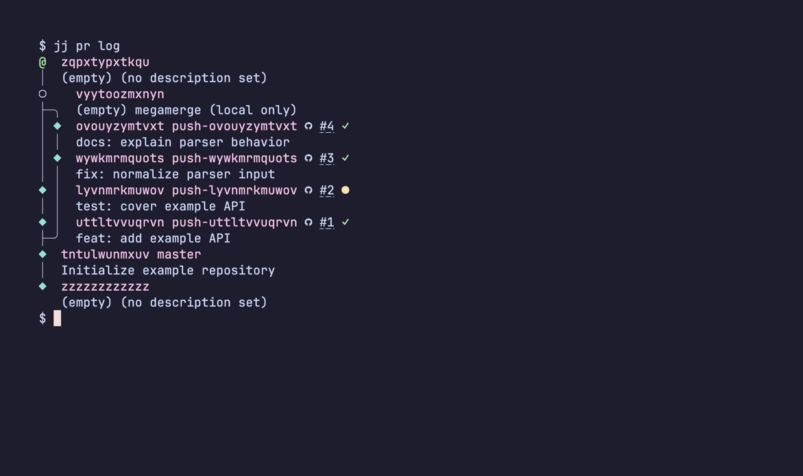

# jj-gh

GitHub pull request workflows for [Jujutsu (`jj`)](https://github.com/jj-vcs/jj), from your terminal.

- Create PRs from revisions with your editor, templates, and frontmatter.
- Create and reconcile [GitHub stacked PRs](https://github.com/orgs/community/discussions/201439) from your local `jj` graph.
- See PR numbers, CI, and merge status in `jj pr log`.
- Fetch PRs into local bookmarks, including across forks.
- Enable auto-merge and rerun CI by PR number or revision.

Works well with the [`jj` megamerge workflow](https://isaaccorbrey.com/notes/jujutsu-megamerges-for-fun-and-profit); `jj-gh` manages the PRs, not the local megamerge itself.



For guides, configuration, and the complete CLI reference, see the **[documentation](https://mrjones2014.github.io/jj-gh/)**. The site describes the latest stable release.

## Requirements

`jj` must be on `PATH`, and the repository must use the Git backend. `pr fetch` fetches GitHub's special `refs/pull/123/head` refs via [gix](https://github.com/GitoxideLabs/gitoxide) because `jj` cannot yet fetch arbitrary refs.

## Install

<details>
<summary>With Nix</summary>

Add the flake input. The `stable` branch points to the latest release; use `github:mrjones2014/jj-gh` to follow `master`, or `github:mrjones2014/jj-gh/jj-gh-v0.3.1` to pin to a release tag:

```nix
{
  inputs.jj-gh.url = "github:mrjones2014/jj-gh/stable";
  outputs =
    {
      self,
      nixpkgs,
      jj-gh,
      ...
    }:
    {
      # use jj-gh.packages.${system}.default
    };
}
```

Use the overlay or the Home Manager module. The package installs a manpage: `man jj-gh`.

```nix
{ jj-gh, pkgs, ... }:
{
  # Overlay; not needed with the Home Manager module.
  nixpkgs.overlays = [ jj-gh.overlays.default ];
  home.packages = [ pkgs.jj-gh ];

  # Home Manager
  imports = [ jj-gh.homeManagerModules.default ];
  programs.jujutsu.gh = {
    enable = true;
    # aliases = { pr = "pr"; };
    settings.gh_askpass = [ "op" "read" "op://Private/GitHub/token" ];
  };
}
```

Optionally use the Cachix binary cache:

- URL: <https://jj-gh.cachix.org>
- Public key: `jj-gh.cachix.org-1:N1uFBMDd9znlhDa68BRqLSXYzXXJ2+WHVuwxpGxCtDo=`

</details>

<details>
<summary>Precompiled binary</summary>

Download and extract the archive for your platform from the [latest GitHub release](https://github.com/mrjones2014/jj-gh/releases/latest). The Linux and macOS archives contain the binary and manpage. For example:

```sh
mkdir -p ~/.local/bin ~/.local/share/man/man1
install -m 755 jj-gh ~/.local/bin/jj-gh
install -m 644 jj-gh.1 ~/.local/share/man/man1/jj-gh.1
```

Ensure `~/.local/bin` is in `PATH` and `~/.local/share/man` is in `MANPATH`.

</details>

<details>
<summary>With cargo-binstall</summary>

Requires [cargo-binstall](https://github.com/cargo-bins/cargo-binstall):

```sh
cargo binstall jj-gh
```

</details>

<details>
<summary>From crates.io</summary>

Requires a Rust toolchain:

```sh
cargo install jj-gh
```

</details>

<details>
<summary>From source</summary>

Requires a Rust toolchain. Clone this repository, then from its root:

```sh
cargo install --path .
```

</details>

### Set up the `jj` alias

Add this to your jj config to use `jj pr`. The Home Manager module can set it up for you.

```toml
[aliases]
pr = ["util", "exec", "--", "jj-gh", "pr"]
```

Authenticate with `gh auth login`, then try `jj pr log` or `jj pr stack --dry-run`. See the [getting started guide](https://mrjones2014.github.io/jj-gh/getting-started.html) for more.
