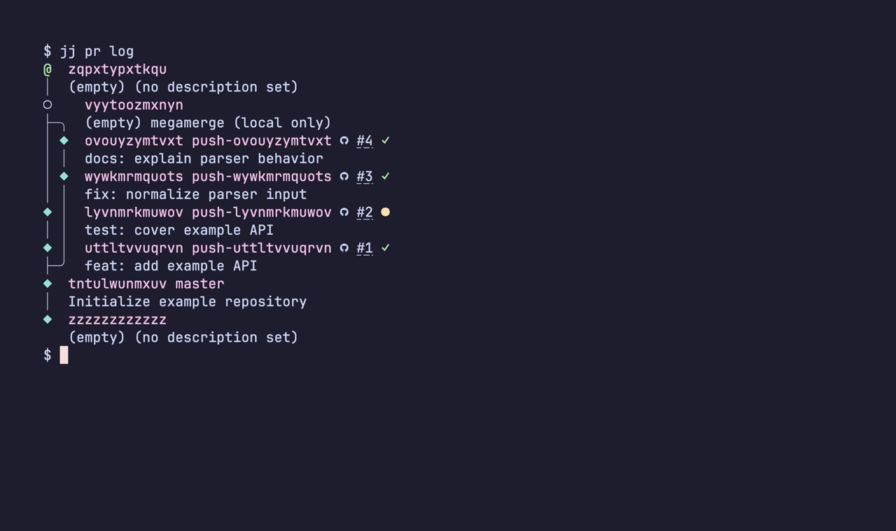

# Introduction

`jj-gh` brings GitHub pull request workflows into [Jujutsu (`jj`)](https://github.com/jj-vcs/jj). It works with the `jj` Git backend, so you can create, inspect, and reconcile PRs while staying in your terminal and in the `jj` graph.

## Highlights

- **Create PRs from arbitrary revisions.** `jj pr create <rev>` opens your editor on a Markdown body seeded from your configured `jj` template or repository PR template. YAML frontmatter controls title, base, labels, reviewers, draft state, and auto-merge. The nearest ancestor bookmark can supply the base branch. See [Configuration](./configuration.md) and [Templates](./templates.md).
- **Native GitHub stacked PRs.** New PRs can be linked into GitHub's [stacked PRs](https://github.com/orgs/community/discussions/201439) feature automatically. `jj-gh` links new PRs on top of an existing stack and reshapes stacks as your local graph changes. See [Stacked PRs](./stacked-prs.md).
- **Stack reconciliation.** `jj pr stack` compares your local PRs with the `jj` graph and proposes a plan to create, reshape, or dissolve GitHub stacks so GitHub matches your local chains. It prints the plan and asks for confirmation before making changes; `--dry-run` prints it and stops. See [Reconciling stacks](./stack-reconciliation.md).
- **PR metadata in the log.** `jj pr log` injects PR number, URL, CI status, and merge status into `jj log`-style output.

  

- **Fetch PR bookmarks across forks.** `jj pr fetch 1234` creates a local bookmark for the PR head, including PRs from forks: `jj pr fetch 1234 && jj new pr-1234/...`. See [Fetch](./workflows/fetch.md).
- **Auto-merge and CI reruns.** Enable auto-merge from a revision ID (`jj pr auto-merge zqxy`) without looking up the PR number, and re-run failed CI with `jj pr rerun`. See [Auto-merge and rerun](./workflows/auto-merge-rerun.md).

## Relationship to megamerge workflows

`jj-gh` works well with the [`jj` megamerge](https://isaaccorbrey.com/notes/jujutsu-megamerges-for-fun-and-profit) workflow, but it does **not** create or manage the megamerge itself. You shape the local `jj` graph (for example with `jj rebase`); `jj-gh` creates, edits, and reconciles the PRs that represent that shape. See [Megamerge workflow](./megamerge.md).

## Where to go next

- [Installation](./installation.md) — install `jj-gh` and set up the `jj pr` alias.
- [Getting started](./getting-started.md) — the minimal first-use flow.
- [Authentication](./authentication.md) — provide a GitHub token.
- [Everyday workflows](./workflows/overview.md) — log, edit, fetch, auto-merge, and rerun.
- [CLI reference](./reference/cli.md) — the full generated command reference.
