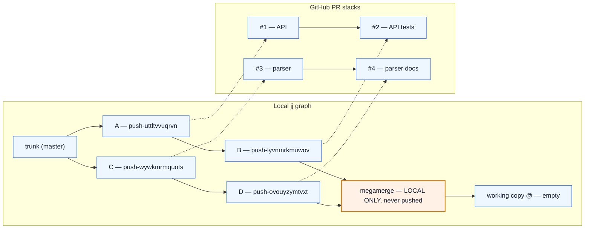

# Megamerge workflow

A **megamerge** is a local, usually empty octopus merge commit whose parents are all the working branches you care about. You work on top of it, so your working copy always sees the combined sum of your changes. Crucially, **you do not push the megamerge**: only the individual branches it combines are pushed. See [Jujutsu megamerges for fun and profit](https://isaaccorbrey.com/notes/jujutsu-megamerges-for-fun-and-profit) for the origin of the workflow.

`jj-gh` is compatible with this shape, but it does **not** create, manage, or push a megamerge. It works from the branches underneath: it discovers chains from bookmarked ancestors and publishes/reconciles PRs for those branches. The merge commit is a descendant of the PR heads, so it is not an ancestor and never becomes a PR base; since it is not pushed and tracked, it is not a PR head candidate either.

## Local shape → GitHub stacks

Two independent chains feed one local megamerge. Dotted arrows map their
bookmarks to the corresponding GitHub PRs:



The megamerge is a local integration point. The two chains map to **two** GitHub stacks, not one stack of four PRs. `jj-gh` can create those stacks after the individual PRs exist:

| Local chain     | GitHub stack | PR bases and heads                                                                                      |
| --------------- | ------------ | ------------------------------------------------------------------------------------------------------- |
| `trunk → A → B` | `#1 → #2`    | `#1`: base `master`, head `push-uttltvvuqrvn`; `#2`: base `push-uttltvvuqrvn`, head `push-lyvnmrkmuwov` |
| `trunk → C → D` | `#3 → #4`    | `#3`: base `master`, head `push-wywkmrmquots`; `#4`: base `push-wywkmrmquots`, head `push-ovouyzymtvxt` |

Only the four `push-` bookmarks get pushed. These names follow jj's default `"push-" ++ change_id.short()` template. The base of each upper PR is the lower PR's head branch on GitHub, mirroring the bookmarked ancestor in jj.


## Working with jj-gh in this shape

```sh
# Build/reshape branches locally, then integrate them into the megamerge
jj absorb                       # fold WIP into the branches below
jj restack                      # alias below: rebase mutable work onto trunk()

# Publish the branches, bottom to top; jj-gh auto-links the two chains
jj pr create uttltvvuqrvn lyvnmrkmuwov wywkmrmquots ovouyzymtvxt

# Check what GitHub would end up with
jj pr stack --dry-run
```

`jj pr create` pushes each revision and its bookmark, then best-effort auto-links detected chains. `jj pr stack` reads the same local graph and can retarget PR bases, push stale bookmarks, and create or reshape the two GitHub stacks. Neither command touches the megamerge commit or rewrites local history.

## Helpful jj aliases

These aliases are from the article, not from `jj-gh`. Add them to `~/.config/jj/config.toml` (or repo config) if you use the megamerge workflow; the `pr` alias shown here is the usual `jj-gh` setup.

```toml
[revset-aliases]
"closest_merge(to)" = "heads(::to & merges())"

[aliases]
pr = ["util", "exec", "--", "jj-gh", "pr"]
# Insert a revset between trunk and the closest megamerge
stack = ["rebase", "--after", "trunk()", "--before", "closest_merge(@)", "--revision"]
# Stage the whole unmerged stack after the megamerge
stage = ["stack", "closest_merge(@)+:: ~ empty()"]
# Rebase mutable work onto trunk without dragging along others' branches
restack = ["rebase", "--onto", "trunk()", "--source", "roots(trunk()..) & mutable()", "--simplify-parents"]
```

Keep the megamerge unpushed and untracked. If you accidentally give it a bookmark, do not push that bookmark or pass it to `jj pr create`.
