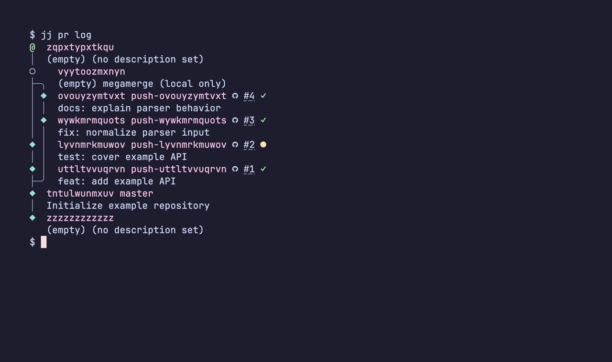

# PR metadata in `jj log`

`jj pr log` (alias `jj pr l`) is `jj log` with open-PR metadata rendered inline: hyperlinked PR number, CI status icon, and merge state (merged / in merge queue / auto-merge enabled).

## How it works

`jj-gh` does not reimplement log rendering. It looks up open PRs, writes a temporary `jj` config that defines `pr_*` template aliases keyed by `commit_id`, then runs `jj --config-file <temp> log`. Aliases are keyed on the commit your local bookmark points at, so the badge stays on your working copy even if you rebased or squashed without pushing.

Anything after `--` is forwarded verbatim to `jj log`:

```sh
jj pr log -- -r 'mine()'
jj pr log -- -r 'trunk()..@' -T builtin_log_compact
```

## Templates

A default template mirroring jj's own commit header with PR metadata added is applied unless you pass your own `-T`/`--template` in the forwarded args:

```sh
# Use your own jj log template (the default PR-aware template is not applied)
jj pr log -- -T 'commit_id.short() ++ " " ++ description.first_line() ++ " " ++ pr_meta'

# Change the body of the injected default template for this invocation,
# while still using the merged PR metadata
jj pr log -T 'format_short_commit_header(self) ++ "#" ++ pr_number'
```

The `-T` **after** `--` is a `jj log` template and disables the injected default. The `-T` **before** `--` overrides the `pr_log_template` config for the injected `pr_log` alias only; it has no effect if you supply your own template after `--`.

Standard jj template builtins are available. These aliases are injected per commit (empty for commits without a matching open PR):

| Alias             | Value                                                                  |
| ----------------- | ---------------------------------------------------------------------- |
| `pr_number`       | PR number as a string                                                  |
| `pr_url`          | PR URL                                                                 |
| `pr_ci_status`    | `SUCCESS`, `FAILED`, or `PENDING`                                      |
| `pr_merge_status` | merged / in-merge-queue / auto-merge label                             |
| `pr_meta`         | Pre-formatted hyperlinked PR number, colored CI icon, and merge status |

See [Templates](../templates.md) for the full alias reference and `pr_log_template`.

## Nerdfonts

The default template uses Nerd-Font glyphs when `nerdfonts = true` (the default). Toggle per invocation with `--nerdfonts` / `--no-nerdfonts`, or permanently in [Configuration](../configuration.md). If glyphs render incorrectly, the pager is usually the culprit; a `bat` pager or `less` with `LESSCHARSET=utf-8` works.

## Screenshot


